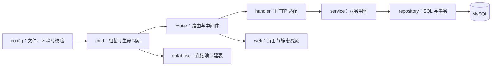

# 分层与配置约定

pic 参考同级 hexis 的 Go 包组织。HTTP 继续使用标准库，MySQL 继续使用现有驱动；API 地址和 JSON 结构保留。

`model` 是各层共享的纯数据类型，不依赖 HTTP、数据库或配置。`catalog` 仅用于离线资料加载、校验及测试资料；运行时 API 通过 repository 查询 MySQL，没有 JSON 后备。导入命令通过 `importer` 准备批次，再交给 repository 事务入库。

## 本机制作与数据库维护

`scripts/materials.py` → 本机 `cmd/materials` → `service.Materials` → repository → MySQL。不新增公开写接口或服务器后台；`read` 返回完整书目及快照版本，`save` 在事务内锁定并校验版本后写入。制作失败或版本冲突不覆盖已有内容，正文改变清理对应语言旧音频。脚本仅在内存/自动清理的临时目录里适配旧生成实现，不再维护 content/books。`snapshot-tests` 只读生成离线测试夹具，运行和制作均不读取测试快照。

部署仍为服务器 `deploy.sh` 的 git pull、Go 编译和 systemd 重启；不使用 Docker。书目 JSON 已取消 Git 跟踪，本机历史备份保留。

## 各层职责

| 包 | 职责 |
| --- | --- |
| `cmd/api` | 加载配置、连接数据库、组装依赖、启动及关闭 HTTP 服务 |
| `cmd/dbinit` | 解析命令行参数，调用数据库初始化能力 |
| `cmd/importer` | 仅兼容历史文件迁移；不作为日常制作入口 |
| `cmd/materials` | 本地查库、校验、带版本保存的命令适配；不暴露 HTTP 写接口 |
| `internal/config` | 自动读取配置文件、环境覆盖、默认值和有效性检查 |
| `internal/router` | 注册路径、HTTP 方法、安全响应头与异常恢复 |
| `internal/handler` | 转换请求参数，将业务结果、错误映射为 JSON 与 HTTP 状态码 |
| `internal/service` | 分页与关键词规则、列表/详情、可见页面组织、分类及健康检查 |
| `internal/repository` | 参数绑定、发布过滤、查询关系组装、写前完整校验与批量事务 |
| `internal/model` | 绘本、页面、授权、语音、查询与字典模型 |
| `internal/database` | 驱动配置、连接池、数据库连接与可信 schema 执行 |
| `internal/catalog` | JSON 与素材路径、页序、文本校验，收集资源交给检查器 |
| `internal/assets` | 本地或独立素材域名的存在、类型与非空校验，去重并限制并发 |
| `internal/importer` | 整批加载、显式发布状态覆盖、可选授权校验 |
| `internal/web` | 公共文件白名单、静态资源和 SPA 页面框架 |

handler 不操作 SQL，router 不读取配置、数据库或内容。service 将缺书、参数无效和基础设施故障分类，handler 分别返回 404、400、503，并隐藏数据库诊断信息。建表与导入命令不承担 HTTP 逻辑。

## 配置文件

采用 hexis 的 `.env` 文件形式，使用 `godotenv` 解析；将 `.env.example` 复制为 `.env` 并填写数据库参数即可。不必手动 source，不依赖 shell 展开密码。所有 Go 命令使用同一加载器。

配置文件选择顺序：`--config` 参数 → `CONFIG_FILE` 环境变量 → 当前工作目录 `.env`。自定义文件缺失时报错；只有默认 `.env` 缺失时允许使用环境配置或默认值。

配置值优先级：命令行目录参数（如 `--content`、`--web`、`--schema`）→ 环境变量 → 文件 → 程序默认值。显式空环境值也参与覆盖；非法地址、端口、布尔、时长、连接池大小等会导致启动失败。错误仅说明配置项，不输出秘密值。密码需要保留 `#`、`$` 或空格时用单引号包裹。

配置按 `Server / Database / Content` 分组，包括 HTTP 地址和超时、数据库连接与连接池、目录、建表 SQL 和授权开关。`.env.example` 提供完整键名和默认值。初期 `REQUIRE_LICENSE_APPROVAL=false`，不会自行开启严格审核。

`Content.AssetBaseURL` 对应 `ASSET_BASE_URL`，留空使用本地素材。非空时由 service 在 API 响应中为封面、页面图片和音频的 `/assets/…` 路径添加前缀，repository 和离线导入资料保持相对路径。router 仅允许该域名来源的图片与音频通过 CSP。`ASSET_CHECK_MODE=auto/local/remote`、`ASSET_CHECK_TIMEOUT`、`ASSET_CHECK_CONCURRENCY` 控制 Go 导入前资源检查；auto 在本地文件缺失时校验域名。资源检查在数据库写入前完成，失败不入库，运行时 API 不执行这些检查。完整部署步骤见 [operations.md](operations.md)。

相对路径以进程工作目录为准，不以配置文件所在目录为准。环境、文件读取集中在 config，不再散落在 handler、service、repository、database 或各命令的辅助函数中。配置修改需重启对应命令；MySQL 绘本数据仍在每次请求时读取。

## 检查

`make test` 验证配置、业务规则、路由契约、SQL 查询/事务和现有前端流程。`go run ./cmd/importer --config .env.example --validate-only` 可验证配置与资料链路，无需数据库。真实 MySQL 和浏览器验证边界见 [acceptance.md](acceptance.md)。
